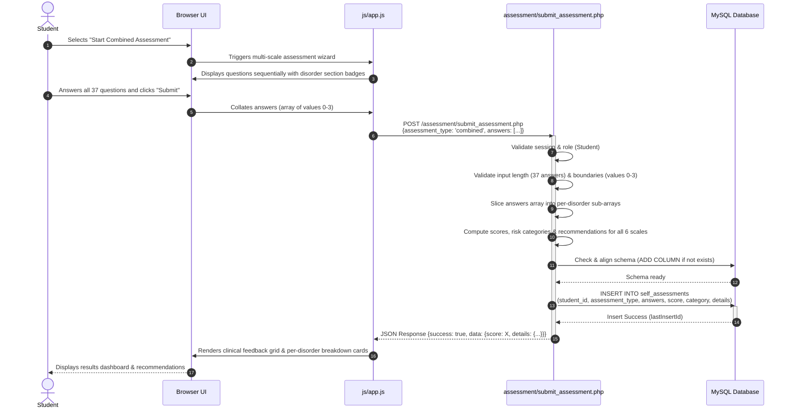
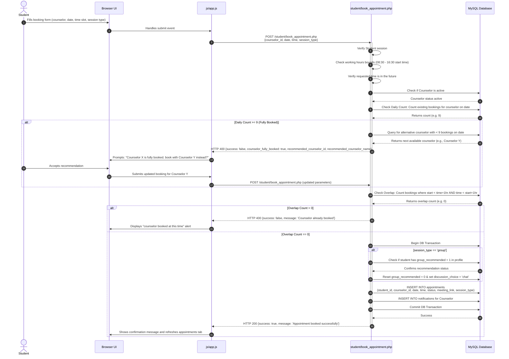
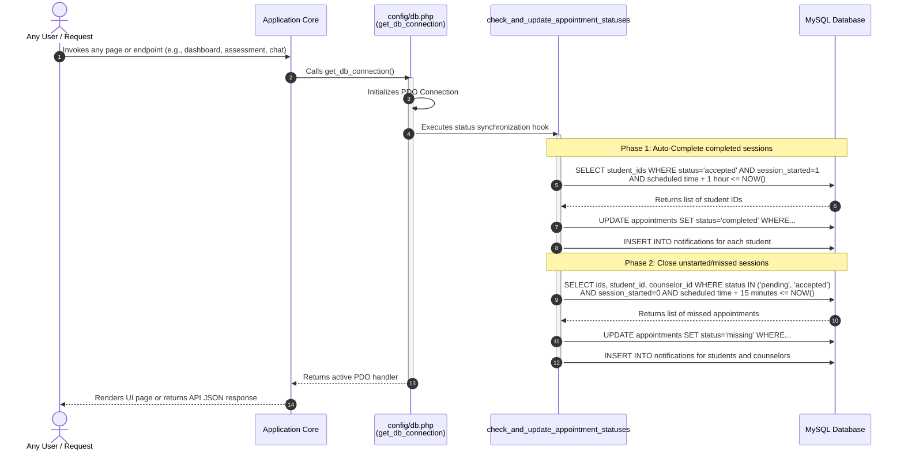
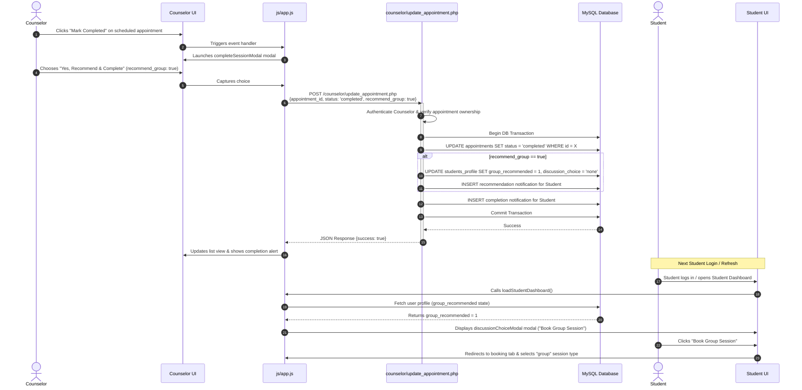
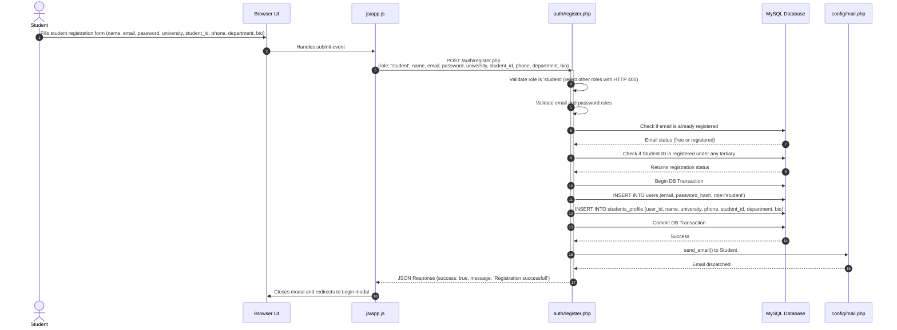
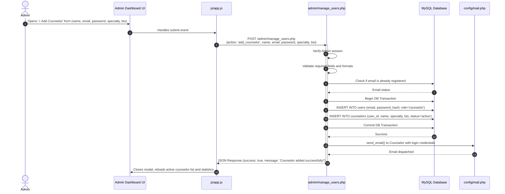

# Sequence Diagrams: Digital Mental Health Support Platform

This document outlines the detailed sequence diagrams mapping the critical logic flows of the **Digital Mental Health Support Platform**. These diagrams illustrate the interaction between the Client (Browser/JS), backend PHP REST APIs, and the relational MySQL database.

---

## 1. Combined Self-Assessment Submission & Analysis

This flow illustrates how a student takes the 37-question combined self-assessment (covering GAD-7, PHQ-9, MDQ, PC-PTSD-5, PSS-4, and Rosenberg Self-Esteem Scale), and how the backend parses the answers per-disorder to calculate scores, severity risk categories, and clinical recommendations.



- **Related Files:**
  - Client wizard & rendering: [js/app.js](file:///C:/wamp64/www/mental_support/js/app.js)
  - Processing & analysis: [assessment/submit_assessment.php](file:///C:/wamp64/www/mental_support/assessment/submit_assessment.php)
  - History querying: [student/get_assessments.php](file:///C:/wamp64/www/mental_support/student/get_assessments.php)

---

## 2. Student Appointment Booking & Overlap Validation

This diagram details the booking validation flow, including the 1-hour session duration logic, workday bounds, daily counselor booking capacity (max 9 slots), automatic recommended counselor fallback, and group discussion eligibility check.



- **Related Files:**
  - Booking UI controls: [dashboard_student.html](file:///C:/wamp64/www/mental_support/dashboard_student.html)
  - Validation & reservation: [student/book_appointment.php](file:///C:/wamp64/www/mental_support/student/book_appointment.php)

---

## 3. Appointment Auto-Lifecycle Synchronization

The platform performs automatic, real-time lifecycle updates on *every database connection* (triggered by any web load or API call) to enforce constraints on missed and completed sessions.



- **Related Files:**
  - Database & hook: [config/db.php](file:///C:/wamp64/www/mental_support/config/db.php)

---

## 4. Counselor Session Completion & Manual Group Recommendation

This diagram maps the counselor manually completing a session, prompting them to recommend group discussion support, and the subsequent student booking workflow.



- **Related Files:**
  - Counselor dashboard: [dashboard_counselor.html](file:///C:/wamp64/www/mental_support/dashboard_counselor.html)
  - Completion logic: [counselor/update_appointment.php](file:///C:/wamp64/www/mental_support/counselor/update_appointment.php)
  - Student dashboard: [dashboard_student.html](file:///C:/wamp64/www/mental_support/dashboard_student.html)

---

## 5. Community Group Discussion Chat & Polling Loop

This diagram outlines how community group messages are sent and retrieved in real-time by participants (students, counselors, or administrators) via continuous polling.

```mermaid
sequenceDiagram
    autonumber
    actor Participant as Student, Counselor, or Admin
    participant UI as Dashboard UI
    participant JS as js/app.js
    participant SendAPI as chat/send_message.php
    participant RecvAPI as chat/get_messages.php
    participant DB as MySQL Database

    Note over Participant, JS: Message Send Sequence
    Participant->>UI: Types message in "Community Discussions" tab & clicks Send
    UI->>JS: Invokes sendGroupMessage()
    JS->>SendAPI: POST /chat/send_message.php<br/>{chat_type: 'group', message: 'Hello community'}
    
    activate SendAPI
    SendAPI->>SendAPI: Validate session & retrieve sender ID/role
    SendAPI->>DB: INSERT INTO group_discussions (sender_id, content)
    DB-->>SendAPI: Success
    SendAPI-->>JS: JSON Response {success: true}
    deactivate SendAPI
    JS->>UI: Clears input box & immediately calls loadGroupMessages()

    Note over JS, RecvAPI: Message Retrieval / Polling Loop (Every 4s)
    loop Every 4 seconds
        JS->>RecvAPI: GET /chat/get_messages.php?action=group
        activate RecvAPI
        RecvAPI->>DB: SELECT messages JOIN users, students_profile, and counselors<br/>(COALESCE sender names)
        DB-->>RecvAPI: Returns array of group messages
        RecvAPI-->>JS: JSON Response [{id, sender_name, sender_role, content, timestamp}]
        deactivate RecvAPI
        JS->>UI: Formats and inserts message bubbles into #discussionMessagesBox
        UI->>UI: Auto-scrolls chat window to the bottom
    end
```

- Related Files:
  - Messaging interface: [dashboard_student.html](file:///C:/wamp64/www/mental_support/dashboard_student.html) & [dashboard_counselor.html](file:///C:/wamp64/www/mental_support/dashboard_counselor.html)
  - Direct message endpoints: [chat/send_message.php](file:///C:/wamp64/www/mental_support/chat/send_message.php) & [chat/get_messages.php](file:///C:/wamp64/www/mental_support/chat/get_messages.php)
  - Messaging loops: [js/app.js](file:///C:/wamp64/www/mental_support/js/app.js)

---

## 6. Student Account Self-Registration

Only students are allowed to self-register via the landing page registration form.



- **Related Files:**
  - Registration UI form: [index.html](file:///C:/wamp64/www/mental_support/index.html)
  - Processing & registration: [auth/register.php](file:///C:/wamp64/www/mental_support/auth/register.php)

---

## 7. Admin Counselor Creation & Welcome Credentials Email

Administrators create counselors directly in the admin dashboard, immediately activating them and sending their login credentials.



- **Related Files:**
  - Admin Dashboard UI: [dashboard_admin.html](file:///C:/wamp64/www/mental_support/dashboard_admin.html)
  - Admin User API: [admin/manage_users.php](file:///C:/wamp64/www/mental_support/admin/manage_users.php)
  - Core event handling: [js/app.js](file:///C:/wamp64/www/mental_support/js/app.js)
